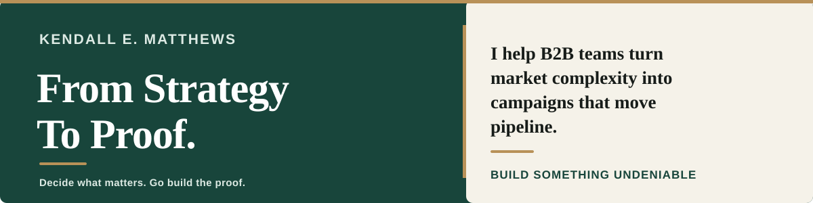

## Hi, I'm Kendall.

I've spent more than 15 years leading marketing teams, go-to-market work, and operations across cybersecurity, SaaS, eCommerce, and AI automation. I have owned budgets, developed teams, and worked across functions and regions. What interests me most is the decision behind the work: **What needs to change, who owns it, and how will we know whether it worked?**

That question is why I build and test AI-assisted tools. Not to collect another stack of software, but to challenge assumptions, improve decisions, and make useful work repeatable.

### Work you can inspect

**[Second-Pass Audit](https://github.com/kendall-matthews/second-pass-audit)**  
*Check important AI-assisted work against its sources before deciding what to ship.*

I turned a practical review problem into a reusable method: compare the output with the source, find material gaps, correct and recheck, then decide **SHIP / REVISE / HOLD**. The repository includes the instructions, examples, and limitations. It is a working method, not a guarantee of correctness.

**[AI Buyer Simulator: I Built One, Then Realized I Rigged the Test](https://kendallmatthews.com/ai-buyer-simulator-loop-marketing-test/)**  
*An experiment in testing messaging without mistaking AI-generated reactions for customer evidence.*

The first version reflected too many of my own assumptions. I documented that flaw and revised the approach. The case study explains what changed and why. It is a published experiment, not a public code repository or proof of buyer validation.

### Leadership and results

My GitHub projects show how I test ideas. My professional work shows how I lead their execution.

- **Global coordination:** As Global Campaigns & Product Marketing Director at Futurex, I lead positioning and integrated go-to-market work, coordinating regional marketing managers, social media, and agencies across international markets.
- **Acquisition performance:** As Head of Marketing at ElectroNeek, I helped reduce North American cost per lead from **$124 to $22 in five months** through campaign and channel optimization, while supervising **15+ global remote team members**.
- **Team building:** As Vice President of Global Marketing & Communication at AppointmentPlus (now DaySmart), I grew the marketing organization from **two to 12 direct reports** and managed marketing priorities and budgets.

Those are different kinds of evidence. My [Selected Work & Results](https://kendallmatthews.com/selected-work-results/) page explains the responsibilities, figures, and attribution in more detail.

### How I approach the work

**Learn → Apply → Transform.** Learn enough to make a responsible decision. Apply the smallest useful change. Make it repeatable when the evidence supports doing so.

A tool is useful when it helps the people doing the work. Otherwise, it's another thing to maintain.

### More about my work

[**Website**](https://kendallmatthews.com/) · [**Selected Work & Results**](https://kendallmatthews.com/selected-work-results/) · [**About**](https://kendallmatthews.com/about/) · [**LinkedIn**](https://www.linkedin.com/in/kendallmatthews/) · [**Work with Kendall**](https://kendallmatthews.com/technology-advances/)

*I share work that is appropriate to publish. Confidential employer and client information stays private.*
